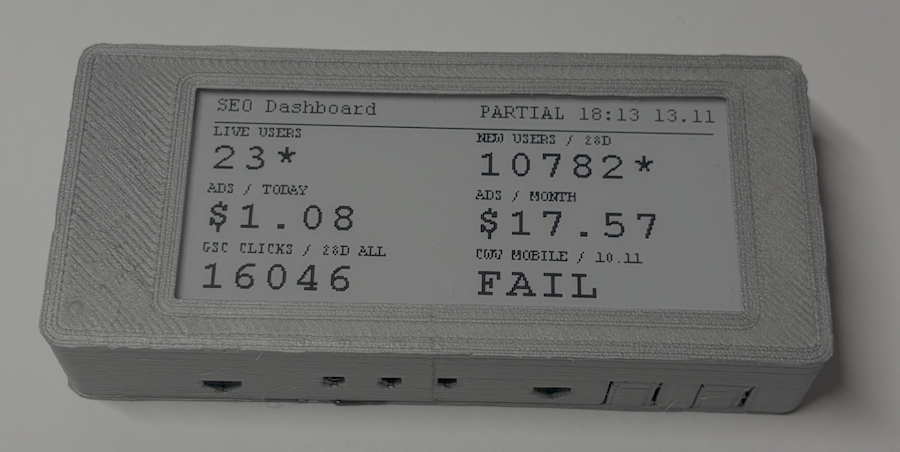

# ESP32 SEO Dashboard

A small e-paper display for your website's earnings, traffic, search performance,
and Core Web Vitals. Built with an ESP32-C3, a Waveshare 2.9-inch display, and a
3D-printed enclosure.



The ESP32 connects directly to Google APIs over Wi-Fi. Once configured, it runs
from USB power without a computer or a separate backend. Choose the services you
need, then use the built-in BOOT button to switch between the overview and
individual service pages.

## What it shows

| Service | Overview | Service page |
| --- | --- | --- |
| Google AdSense | Estimated earnings today and this month | Today, yesterday, last 7 days, month to date, unpaid balance, latest payment |
| Google Analytics 4 | Active users in the last 30 minutes and new users over 28 days | Live, new and total users, sessions, views, engagement rate |
| Google Search Console | Clicks over 28 days | Clicks, impressions, CTR, average position, report dates |
| Core Web Vitals | Mobile PASS / FAIL / NO DATA | LCP, INP, CLS at p75, quality labels, collection dates |

Every service is optional. The layout adapts to the configured services, and
successful results are cached across restarts. A temporary failure keeps the
previous values and marks them with `*`.

## Features

- Local browser settings for Wi-Fi and Google connections.
- Up to three Wi-Fi networks, tried in priority order.
- Light and dark themes, 180° rotation, and a configurable display title.
- Selectable time zone and a refresh interval of 5–1440 minutes; 15 by default.
- An overview plus four service pages, using the board's existing BOOT button.
- A removable printed enclosure with integrated BOOT and RST buttons.

Core Web Vitals is normally fetched once per 24 hours. The clock in the header
shows when the frame was rendered; it is not a continuously updating clock.
Report periods follow each service's own time zone and data availability.
See [metrics and timing](docs/development.md#reports-and-data-periods) for details.

## Build one

You will need:

| Part | Quantity | Notes |
| --- | --- | --- |
| ESP32-C3 SuperMini | 1 | USB-C, 4 MB flash; match the board shape if using this enclosure |
| Waveshare 2.9-inch e-Paper Module | 1 | Black-and-white V2 / Rev 2.1, SSD1680, 296 × 128 pixels |
| Short insulated wires | 8 | Power and SPI; soldered directly for the compact enclosure |
| M2 × 4 mm screws | 4 | Display mounting; check actual screw head fit |
| Printed case, tray, and rear lid | 1 each | [STL files](3D/STL) |
| USB-C data cable and USB power source | 1 each | A data cable is required for uploading firmware |

The supported combination is specific: other ESP32 boards and other 2.9-inch
panels can require different pin assignments, drivers, or enclosure dimensions.

1. **[Connect the hardware](docs/hardware.md)** — parts, pin map, and direct wiring.
2. **[Upload and run](docs/getting-started.md)** — Arduino IDE settings and first boot.
3. **[Connect Google services](docs/google-setup.md)** — enable APIs and obtain credentials.
4. **[Print and assemble](docs/assembly.md)** — print orientations and assembly steps.

You can complete Wi-Fi setup with all Google services disabled and add them later.
Check the electronics before closing the enclosure.

## First connection

After uploading, a device without saved Wi-Fi starts this setup network:

| Setting | Value |
| --- | --- |
| Wi-Fi network | `seo-dashboard-setup` |
| Wi-Fi password | `seodashboard` |
| Setup address | [http://192.168.4.1/](http://192.168.4.1/) |
| Browser login | `admin` / `seodashboard` |

Enter a 2.4 GHz Wi-Fi network, choose your display settings, and save. After the
restart, open [http://seo-dashboard.local/](http://seo-dashboard.local/) on the
same home network, or use the IP address printed in Serial Monitor.

All Wi-Fi and Google settings are entered through this page and stored on the
device. No `secrets.h` file or source edits are needed.

The web page uses a public factory password and local HTTP. Use it on a trusted
network; it has no Internet-facing administration mode. Credentials are stored
in device flash without encryption. More detail is in
[settings and credentials](docs/getting-started.md#settings-and-credentials).

## Controls and status

| Action | Result |
| --- | --- |
| Short BOOT press and release | Next page: Overview → AdSense → GA4 → GSC → CWV |
| Hold BOOT for at least 1.2 seconds, then release | Return to Overview |
| Press RST | Restart the ESP32 |
| Send `setup` plus a newline in Serial Monitor | Open the setup hotspot again |

Unconfigured pages are skipped. Page changes use cached data and do not make
Google requests. The display performs a full refresh, so navigation takes a few
seconds and can wait for an update already in progress. BOOT navigation is
paused while setup instructions are displayed.

`LIVE` means all configured overview services succeeded; `PARTIAL` means some
succeeded; `ERROR` means none did. `SETUP` means no services are enabled.
CWV `FAIL` describes website performance and can appear alongside `LIVE`.
`NO DATA` means no usable field data is available. The web page reports display
refresh health separately from API health.

For connection, authorization, saving, or display problems, see
[troubleshooting](docs/troubleshooting.md).

## Project layout

```text
firmware/SEO_Dashboard/   Arduino sketch, modules, display driver, settings UI
tools/                   Settings UI embedding and local preview
3D/                      Printable STL, STEP, FreeCAD assembly, CAD sources
docs/                    Build, configuration, assembly, and development guides
tests/                   Existing host checks for settings and the display driver
```

For the code map, report definitions, storage, and local UI workflow, see
[development](docs/development.md). For editable models and dimension notes,
see the [enclosure reference](3D/README.md).

## Current scope

Firmware is uploaded from source over USB. This revision has no OTA updates,
battery power management, or Google sign-in inside the device's web page.
Initial Google authorization happens on your computer; the ESP32 subsequently
refreshes its own access tokens. Each builder supplies their own Google Cloud
project and credentials.

The published enclosure has been printed and assembled by the maintainer.
Print fit depends on your printer and on the exact board and cable dimensions.

## License and credits

Original project code and enclosure design are provided under the
[MIT license](LICENSE). The adapted Waveshare driver and STMicroelectronics
bitmap fonts retain their own notices; see
[third-party notices](THIRD_PARTY_NOTICES.md). Third-party board STEP models are
not distributed; the published CAD assemblies contain the enclosure parts only.

This is an independent project and is not affiliated with Google, Espressif,
or Waveshare.
