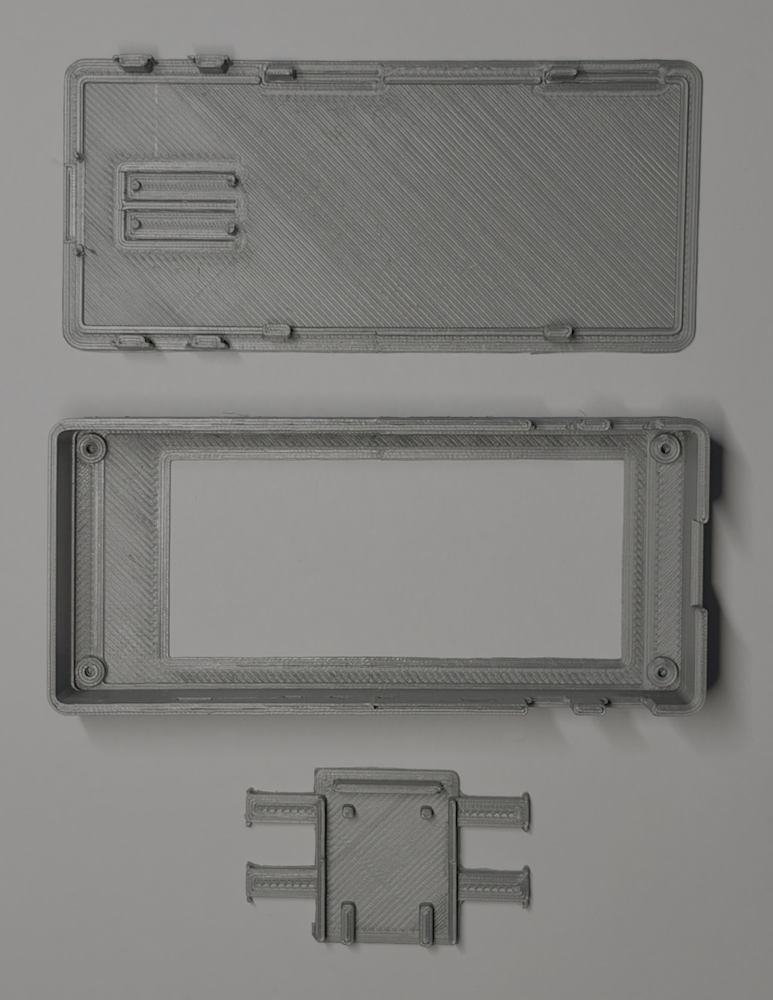
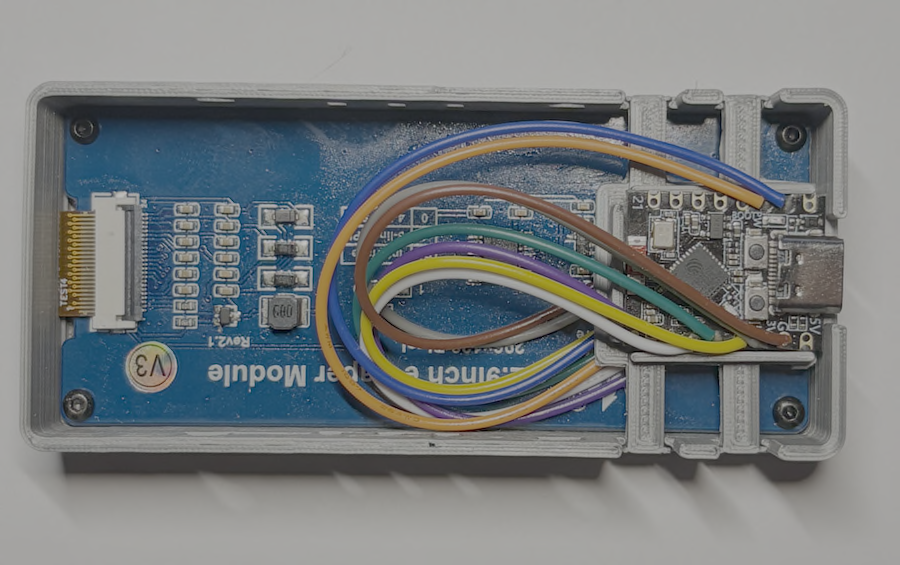

# Printing and assembling the enclosure

[Back to README](../README.md) · [Wiring](hardware.md) · [CAD reference](../3D/README.md)

The enclosure holds the display and a bare ESP32-C3 SuperMini, powered through
the board's USB-C socket. Its assembled size is **93 × 42 × 18.4 mm**. There is
no battery compartment in this version.

## Files to print

Use the three published STL files together:

| Part | File | Place on the print bed |
| --- | --- | --- |
| Front case | [01_case.stl](../3D/STL/01_case.stl) | Front/display face down |
| Insulating tray | [02_insulator_tray.stl](../3D/STL/02_insulator_tray.stl) | Flat floor down |
| Rear lid | [03_rear_lid.stl](../3D/STL/03_rear_lid.stl) | Outside face down, internal features upward |

The filenames form the current compatible set: V7 case, V6 tray, and V8 rear
lid. These revision numbers identify when each part last changed. Download the
current files from `3D/STL/`; do not print an entire STEP assembly as one part.

The STL files already have print orientations and use millimetres. Import them
at **100% scale**; do not stretch one axis to correct a fit problem.

## Slicer starting point

The maintainer's printer is an **Anet A8**, and the enclosure has been printed
in **PLA**. Use a profile calibrated for your own printer and filament:

- **0.4 mm nozzle** and **0.2 mm layer height**.
- **Supports off** for the supplied orientations.
- Keep brim, support, and elephant-foot compensation from closing the button
  and latch slots.
- Review the sliced layers around the hooks, vents, narrow springs, and USB port.
- Use temperatures and speeds appropriate to your filament and printer profile.

The rear plate is **1 mm thick**; at 0.2 mm layers its flat region is five
layers. Its integral BOOT/RST leaves and latch springs must remain separate
from the surrounding plate. The button/latch slots are nominally 0.6 mm wide.

A CuraEngine slicing audit found no support paths at a 55° support threshold;
a 50° threshold adds small supports at the lid's retaining lands. The intended
print is support-free. The audit is separate from physical fit, and its
diagnostic G-code is not a printer profile or a file to send to your Anet A8.
Slice the published STL files for your own machine.

## Before assembly

Prepare four **M2 × 4 mm screws**, the wired boards, the printed parts, and a
small screwdriver. The screw head reference is about 3.7 mm in diameter and
1.4 mm high; check your actual fasteners.

Remove loose strings and edge burrs. Check that the lid leaves move gently and
that its slots are open. Check the USB cable housing against the case opening.
Power the electronics outside the case, verify the wiring, configure the
device, and observe several successful display refreshes. Then disconnect USB.

The compact fit assumes the Waveshare pin connector and ESP32 pin headers are
absent. The flexible display-to-PCB ribbon remains installed.

## Assembly

1. **Seat the display.** Insert the module from the rear, align its four PCB
   mounting holes with the case supports, and place the screen in the front
   window. Leave the display ribbon's folded path free of pinching.
2. **Fasten the display.** Install the four M2 × 4 screws through its existing
   holes. Tighten only enough to hold the PCB. The glass and ribbon must not
   carry clamping force. The display stays fastened when the lid is removed.
3. **Fit the insulating tray.** Place its four mounting keys in the case guides
   near the USB end. The tray floor separates the ESP32 and its solder joints
   from the display PCB.
4. **Seat the ESP32.** Put the bare board on the tray supports with USB-C facing
   the case opening. It should lie flat in its guides, not rest on wires or
   electronic components.
5. **Route the wires.** Keep them clear of the tray seats, lid stops, flexible
   buttons, and side latches. The photograph below shows one completed route;
   leave enough slack to avoid pulling on solder joints.

   

6. **Close the lid.** Engage its two fixed hooks first, then lower the opposite
   edge and gently press until the two releasable latches engage. The lid uses
   no screws. Stop and inspect if it requires force or presses a board button.
7. **Check the finished device.** Connect USB, confirm startup and an actual
   screen update, then try a short BOOT click. Briefly test RST without BOOT.
   Verify that inserting and removing the cable does not lift the ESP32.

The cable load should be reacted by the board-edge supports. The case is not
intended to use the USB socket's solder joints or the antenna as pressure stops.

## Opening the case

Disconnect USB. Through the two side release openings, gently push the movable
hooks inward with a small flat tool. Lift that lid edge, then disengage the
fixed hooks. Do not lever against the display or force the lid from a corner.

The thin PLA flexures have no measured cycle-life rating. Use only enough
travel to release the latch or actuate a button.

## Editable models

- [FreeCAD assembly](../3D/output/assembly/SEO_Dashboard_Minimal_V8.FCStd)
- [Printed parts STEP assembly](../3D/output/assembly/SEO_Dashboard_Minimal_V8_printed_parts.step)
- [Individual enclosure STEP parts](../3D/output/parts-step)
- [Dimensions and FreeCAD editing notes](../3D/README.md)

The assemblies contain only the three enclosure parts, without third-party
board models. Use the assembly photographs and actual board measurements when
adapting the design to another SuperMini revision.
