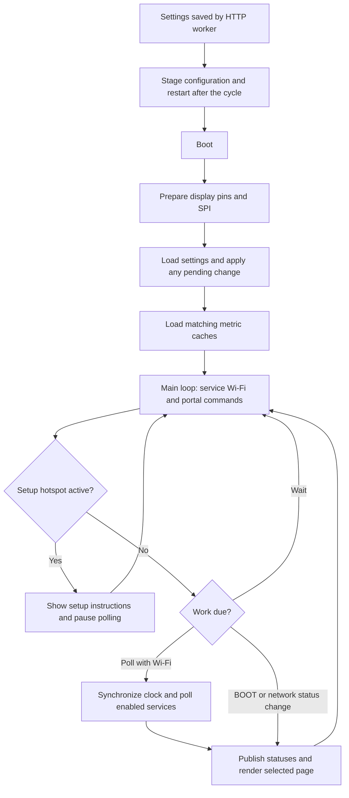

# Development and code map

[Back to README](../README.md) · [Device setup](getting-started.md) · [CAD reference](../3D/README.md)

The firmware is an Arduino sketch split into modules. `.ino` contains startup
and scheduling; `.h` files define types/interfaces and small helpers; `.cpp`
files implement them. The display driver and bitmap fonts are adapted third-party
sources beside the sketch. The application, configuration, and UI modules are
project code, extracted from the original working dashboard.

## Runtime flow



The diagram summarizes the lifecycle. Only the first setup frame is drawn on
entry; subsequent setup-loop iterations wait and service the portal. Saving
settings stages a change and schedules restart; entering setup alone does not.

### Application and display

All paths below are relative to `firmware/SEO_Dashboard/`.

| File | Responsibility |
| --- | --- |
| [SEO_Dashboard.ino](../firmware/SEO_Dashboard/SEO_Dashboard.ino) | Startup, poll scheduling, clock synchronization, provider calls, setup command, and publication of display/API states |
| [dashboard_data.h](../firmware/SEO_Dashboard/dashboard_data.h), [dashboard_data.cpp](../firmware/SEO_Dashboard/dashboard_data.cpp) | Metrics, provider and display states, page enums, and readable status labels |
| [dashboard_button.h](../firmware/SEO_Dashboard/dashboard_button.h), [dashboard_button.cpp](../firmware/SEO_Dashboard/dashboard_button.cpp) | GPIO9 edge capture, debounce, short/long gestures, and selected page |
| [dashboard_pages.h](../firmware/SEO_Dashboard/dashboard_pages.h), [dashboard_pages.cpp](../firmware/SEO_Dashboard/dashboard_pages.cpp) | Explicit page order, titles, service mapping, and skipping disabled pages |
| [dashboard_display.h](../firmware/SEO_Dashboard/dashboard_display.h), [dashboard_display.cpp](../firmware/SEO_Dashboard/dashboard_display.cpp) | Overview/detail/setup layouts, number fitting, stale markers, theme, rotation, and refresh policy |
| [display_options.h](../firmware/SEO_Dashboard/display_options.h) | Supported time-zone IDs, labels, POSIX rules, and lookup |
| [cwv_quality.h](../firmware/SEO_Dashboard/cwv_quality.h) | Shared raw-p75 thresholds and quality labels for CWV |

### Google requests and cached data

| File | Responsibility |
| --- | --- |
| [google_client.h](../firmware/SEO_Dashboard/google_client.h), [google_client.cpp](../firmware/SEO_Dashboard/google_client.cpp) | Certificate-verified TLS, HTTP, OAuth refresh, bounded bodies, and safe error identifiers |
| [google_reports.h](../firmware/SEO_Dashboard/google_reports.h), [google_reports.cpp](../firmware/SEO_Dashboard/google_reports.cpp) | Service endpoints, report definitions, response validation, and complete metric snapshots |
| [report_dates.h](../firmware/SEO_Dashboard/report_dates.h), [report_dates.cpp](../firmware/SEO_Dashboard/report_dates.cpp) | Strict Gregorian date validation shared by reports |
| [json_helpers.h](../firmware/SEO_Dashboard/json_helpers.h) | Scoped cJSON ownership and string access helper |
| [metrics_cache.h](../firmware/SEO_Dashboard/metrics_cache.h), [metrics_cache.cpp](../firmware/SEO_Dashboard/metrics_cache.cpp) | Per-service NVS records, source fingerprints, timestamps, and cache migration |

### Settings and Wi-Fi

| File | Responsibility |
| --- | --- |
| [settings_config.h](../firmware/SEO_Dashboard/settings_config.h) | Network/display settings, validation, timing helpers, and old binary settings format |
| [device_config.h](../firmware/SEO_Dashboard/device_config.h), [device_config.cpp](../firmware/SEO_Dashboard/device_config.cpp) | Complete device configuration, form validation, public/private JSON, and source fingerprints |
| [wifi_networks.h](../firmware/SEO_Dashboard/wifi_networks.h), [wifi_networks.cpp](../firmware/SEO_Dashboard/wifi_networks.cpp) | Ordered network attempts and runtime failover |
| [settings_store.h](../firmware/SEO_Dashboard/settings_store.h), [settings_store.cpp](../firmware/SEO_Dashboard/settings_store.cpp) | Durable active/pending NVS records and supported settings migration |
| [settings_portal.h](../firmware/SEO_Dashboard/settings_portal.h), [settings_portal.cpp](../firmware/SEO_Dashboard/settings_portal.cpp) | Setup access point, DNS, local routes, authentication, status snapshots, staging, and deferred restart |
| [settings_http.h](../firmware/SEO_Dashboard/settings_http.h), [settings_http.cpp](../firmware/SEO_Dashboard/settings_http.cpp) | Request limits before core buffering, early save authorization, and a stable per-boot Digest challenge |
| [web/index.html](../firmware/SEO_Dashboard/web/index.html) | Editable settings page with inline HTML/CSS/JavaScript |
| [settings_assets.h](../firmware/SEO_Dashboard/settings_assets.h) | Generated PROGMEM HTML and Content Security Policy hashes; edit the HTML source instead |

### Driver and fonts

| File | Origin and role |
| --- | --- |
| [epdif.h](../firmware/SEO_Dashboard/epdif.h), [epdif.cpp](../firmware/SEO_Dashboard/epdif.cpp) | Waveshare hardware abstraction adapted to the ESP32-C3 GPIO map, hardware SPI, safe initial levels, and guarded SPI restart |
| [epd2in9_V2.h](../firmware/SEO_Dashboard/epd2in9_V2.h), [epd2in9_V2.cpp](../firmware/SEO_Dashboard/epd2in9_V2.cpp) | Waveshare SSD1680 commands/LUTs, with bounded BUSY diagnostics and local recovery checks |
| [epdpaint.h](../firmware/SEO_Dashboard/epdpaint.h), [epdpaint.cpp](../firmware/SEO_Dashboard/epdpaint.cpp) | Waveshare drawing functions that change pixels in the RAM buffer |
| [fonts.h](../firmware/SEO_Dashboard/fonts.h) | STMicroelectronics bitmap-font structure and declarations, included through the Waveshare example |
| [font8.cpp](../firmware/SEO_Dashboard/font8.cpp) | 5 × 8 bitmap characters |
| [font12.cpp](../firmware/SEO_Dashboard/font12.cpp) | 7 × 12 bitmap characters |
| [font20.cpp](../firmware/SEO_Dashboard/font20.cpp) | 14 × 20 bitmap characters |
| [font24.cpp](../firmware/SEO_Dashboard/font24.cpp) | 17 × 24 bitmap characters |

The font files are largely static glyph tables. All four sizes are used by
adaptive rendering. `Font16` is declared in the imported header but has no local
table and is unused. The driver retains upstream partial/gray methods, but the
dashboard uses full black-and-white refreshes. See [third-party notices](../THIRD_PARTY_NOTICES.md).

Suggested reading order: the sketch → data types → Google reports → display
rendering → portal/config/store → the hardware driver.

## Reports and data periods

| Service | Report definition |
| --- | --- |
| AdSense | `ESTIMATED_EARNINGS`, account time zone, TODAY and MONTH_TO_DATE; detail adds YESTERDAY, LAST_7_DAYS excluding today, and payments |
| GA4 realtime | `activeUsers`, minute range 29 minutes ago through now |
| GA4 history | `newUsers`, `totalUsers`, `sessions`, `screenPageViews`, `engagementRate`; 28 days ago through yesterday in the property time zone |
| GSC | Web, property-wide aggregation, `dataState: all`; 28 Pacific calendar days ending yesterday; clicks, impressions, CTR, position |
| CrUX | One mobile (`PHONE`) origin record: LCP, INP, CLS p75 and the returned collection dates |

AdSense account discovery rejects ambiguity rather than selecting the first
account. Today/month are validated together, including date and currency.
History and payments have independent statuses/timestamps: their failure can
make the detail page PARTIAL while overview earnings remain LIVE. Payment
amounts retain API formatting; common currency symbols become ASCII codes.
YouTube payments are excluded, and missing payments remain `--`. Percentage
comparisons are not implemented.

GA4 makes one realtime and one historical report request. Historical metric
headers are matched by name. The six values replace the previous GA4 snapshot
only when both reports validate. A valid empty report yields zero counts and
an unknown engagement ratio, `--`. GSC requires a complete property-wide row;
empty/malformed reports do not become invented zeros.

CrUX is real-user field data with its own collection window. It is not a lab
audit and not a per-page scan. PASS requires all three good p75 values; a valid
non-good value produces FAIL; missing values otherwise produce NO DATA. A CrUX
404 is treated as valid NO DATA, independently of HTTP errors for other services.
See Google's [CrUX data model](https://developer.chrome.com/docs/crux/api/).

| Metric | GOOD | NEEDS WORK | POOR |
| --- | --- | --- | --- |
| LCP | ≤2.5 s | >2.5–4 s | >4 s |
| INP | ≤200 ms | >200–500 ms | >500 ms |
| CLS | ≤0.1 | >0.1–0.25 | >0.25 |

`NEEDS WORK` is the display's compact wording for “needs improvement.” The
classification uses unrounded values. Near a threshold, additional decimal
places or a boundary notation keep the number and label consistent. Thresholds
follow [Google's CWV definitions](https://web.dev/articles/defining-core-web-vitals-thresholds).

The main poll interval starts **after** requests and the display attempt finish.
CrUX normally reuses a successful result for 86400 seconds; failed requests are
retried on later cycles. Cache reuse does not advance last-success time. A
connection failure can cause another CrUX fetch before that daily interval.

Wi-Fi loss marks configured services WIFI ERROR while preserving values and
timestamps. Reconnection schedules a poll before they return to LIVE. A `*`
means last-known data after a failure; `--` means no known value. Zero remains
zero. Overview status counts primary providers; optional AdSense detail groups
can have their own partial state.

The e-paper header uses frame-render time in the selected display zone.
It does not represent every provider's data age or a continuously ticking clock.
Serial last-success stamps use UTC. The small POSIX table supports Kyiv, UTC,
Warsaw, Berlin, London, New York, Chicago, Los Angeles, Dubai, Kolkata, and Tokyo.
It is not a historical time-zone database. Civil-time rule changes require an
update; local conversions restore UTC before other report calculations.

## Task ownership and display refresh

Only the Arduino task owns mutable metrics, Wi-Fi transitions, SPI, and drawing.
The HTTP/DNS worker runs at lower priority, stages settings, and reads copied
fixed-size status snapshots. It cannot preempt the main task's short display
reset pulse. There is no second rendering task.

BOOT edges enter a bounded ISR buffer, then the Arduino task interprets them.
Debounce is 40 ms; a short release needs at least 60 ms, and a hold of 1.2 seconds
selects Overview. Several queued clicks select the final page with one redraw.
Overflow discards an ambiguous burst. Input captured while setup is active is
discarded. Navigation makes no API requests.

One native **4736-byte** framebuffer holds the 128 × 296 monochrome pixels.
Drawing uses landscape coordinates. Overview uses full-width rows for 1–3
metrics and two columns for 4–6, with an odd final tile spanning the row. Font
fitting picks the largest supported size/scale. Theme inversion and optional
180° byte/bit reversal happen once before transfer; retries reuse that frame.

Refresh resets with a short 2 ms pulse, initializes, clears/writes RAM, and
requires observed BUSY HIGH → LOW before sending display sleep. At most one
SPI recovery retry is allowed, only for REFRESH_NOT_STARTED after a guard sees
no delayed BUSY activity. Other errors do not trigger an unconditional restart
sequence. The original controller LUT/full-update sequence remains.

Display state is separate: WAITING, UPDATING, READY, or ERROR, with frame type,
diagnostic identifier, and last confirmed refresh time. A pre-NTP refresh can
be confirmed without a valid timestamp. READY is BUSY confirmation, not pixel
readback. Last confirmed time stays unchanged after failure and resets at boot.

## Configuration and persistence

Preferences/NVS namespaces are separate:

- **seo-settings**: active and pending complete configuration records.
- **ads-dashboard**: historical namespace name retained for service caches.

Save validates a copy, stores a complete pending record, returns HTTP 202, and
requests restart after the active cycle plus a response grace period. At boot,
changed network lists must connect before promotion; an unchanged list allows
unrelated settings changes even during a temporary outage. Failed confirmation
or persistence keeps the old active record. The pending candidate is consumed.
At least one listed network must work; out-of-range fallbacks are not all
validated immediately.

Wi-Fi attempts follow list order, up to 20 seconds per network. Runtime retries
advance between main-loop iterations. A working lower-priority connection is
kept when a higher-priority network returns. After disconnection a new pass
starts at priority 1; exhausted passes open setup and wait 60 seconds to retry.
Association/IP confirmation is not an Internet or Google-permission check.

Settings JSON is V4, capped at 4096 bytes. Old V1 binary and V2/V3 JSON formats
are supported; prior single networks become priority 1, with normal rotation
and Kyiv time. Missing old titles use SEO DASHBOARD. Merely reading an old
active record does not rewrite it. The obsolete random admin password field
is removed in favor of the public factory default.

Fresh devices use an empty `DeviceConfig`: no networks, credentials, or enabled
services. Firmware has no compile-time credential import. Full V2–V4 settings
records retain their saved connections. The network/display-only V1 format
retains those fields, with Google services disabled until browser configuration.
Reading an invalid record leaves the caller's defaults unchanged.

Metric records are V4 and capped at 2048 bytes per provider. Each complete blob
contains metrics, last-success time, and a SHA-256 connection fingerprint. The
fingerprint covers client ID/secret/token, resource, and API key; title, theme,
Wi-Fi, and the enabled flag are excluded. This binds caches to a source; it
does **not** encrypt credentials. Source-bound old caches migrate, and missing
detail fields stay unknown until a successful expanded fetch. Unbound or
different-source records are ignored. Cache-write failure preserves RAM values.

The browser API returns editable IDs/resources and secret-presence flags. It
never returns stored passwords, client secrets, refresh tokens, or API keys.
Blank secrets retain values only under the matching client. Explicit clear is
staged with the rest of the form; disabling alone retains credentials.

### Credential setup

Firmware settings come only from browser setup and saved NVS records.
The sketch does not include or read `secrets.h`.

The local OAuth recipe for obtaining refresh tokens is documented in
[Google setup](google-setup.md#4-authorize-on-your-computer).

## HTTP, TLS, and resource limits

Google connections use the core's CA bundle and certificate verification.
Redirects are disabled. Access tokens are local to provider fetches. cJSON
documents use scoped ownership. Decoded payloads are bounded while streaming:
8 KiB for OAuth/error bodies and 32 KiB for reports, including chunked or
unknown-length transfers. Content length, framing completion, and strict JSON
parsing are checked before accepting a response.

Incoming settings requests use at most 4 KiB of headers, with a five-second
deadline, and an 8 KiB JSON body, with a ten-second total deadline. Multipart,
transfer-encoded, oversized, and ambiguous-length submissions are rejected.
Digest authentication, host, and per-boot CSRF validation precede save-body
allocation. The Digest challenge is stable for one boot to support parallel
browser requests. An old tab locks Save after restart until reloaded.

The page has inline CSS/JavaScript without a CDN. Generated SHA-256 CSP hashes
allow those exact blocks. Administration remains HTTP with a public factory
password, and NVS credentials are not encrypted; this is a trusted-local-network
design. The HTTP adapter depends on the baseline core's socket/raw-handler
interfaces, which should be reviewed before a core upgrade.

Diagnostics log request labels, duration, heap, signal, and allowlisted error
identifiers. They avoid request URLs, credentials, and complete Google response
bodies. Redact network/account details before sharing any log.

## Editing the settings page

Edit [web/index.html](../firmware/SEO_Dashboard/web/index.html), including its
inline style/script blocks. From the repository root:

```sh
python3 tools/embed_settings_web.py
python3 tools/preview_settings.py
```

The first command regenerates `settings_assets.h` and the CSP hashes. The
second opens a local server at **http://127.0.0.1:8765/**. Its synthetic state
does not contact an ESP32, load real credentials, store submissions, or restart
a device. Use only dummy values there. Stop it with Ctrl+C. `--port` changes
the preview port. Upload rebuilt firmware to change the real device's page.

## Existing host checks

The repository already contains these optional host checks. Python 3 and a
C++ compiler supporting AddressSanitizer/UndefinedBehaviorSanitizer are needed:

```sh
python3 tests/run_settings_tests.py
python3 tests/run_epd_driver_tests.py
```

The settings runner covers the small settings helpers, old record integrity,
password retention, confirmation/restart decisions, timer rollover, and embedded
asset freshness. The driver runner compiles the actual EPD/GPIO code against
mock Arduino/SPI headers and exercises BUSY/retry behavior. These do not emulate
the radio, browser authentication, NVS hardware, Google APIs, or physical pixels;
they are not a claim of complete application coverage.

For an asset-only freshness check:

```sh
python3 tools/embed_settings_web.py --check
```

## Build baseline

The baseline is ESP32-C3, Arduino core **3.3.12**, USB CDC enabled, DIO/40 MHz,
4 MB flash, and Huge APP. A build with browser-only configuration used
**1,435,929 / 3,145,728 bytes** of application flash and **52,408 bytes** of static
RAM. These are reference measurements, not a guarantee for other compiler/core
versions. The build was compiled from an isolated source copy without credential
files; credentials are supplied only at runtime. The project does not store
files in the SPIFFS partition and does not implement OTA.

Keep private configuration, compiled binaries, CAD backups, and machine-specific
G-code out of Git. Commit the editable web source together with its regenerated
header, retain third-party notices, and document changes to hardware assumptions.
