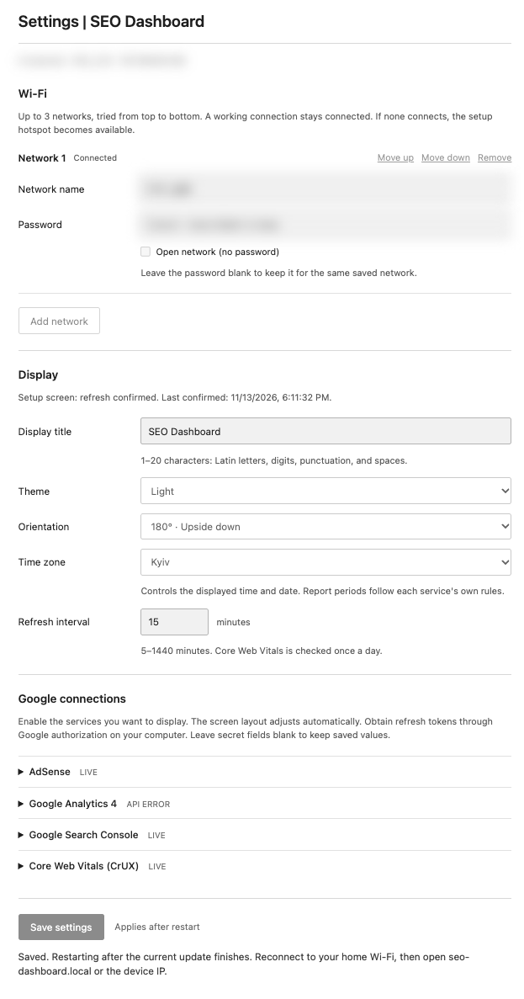

# Uploading firmware and first setup

[Back to README](../README.md)

This guide uses Arduino IDE and the ESP32-C3 SuperMini. You can configure Wi-Fi
and the display before connecting any Google service.

## 1. Get the project

Download and extract the repository ZIP, or clone it:

```sh
git clone https://github.com/AndreyMatviyenko/esp32-seo-dashboard.git
cd esp32-seo-dashboard
```

Keep the entire `firmware/SEO_Dashboard/` folder together. The sketch depends on
the neighboring `.h` and `.cpp` files, including the display driver and fonts.

## 2. Install ESP32 support

1. Install [Arduino IDE](https://www.arduino.cc/en/software/).
2. Open the IDE settings: **Arduino IDE → Settings** on macOS, or
   **File → Preferences** on Windows/Linux.
3. Add this address to **Additional Boards Manager URLs**:

   ```text
   https://espressif.github.io/arduino-esp32/package_esp32_index.json
   ```

4. Open **Boards Manager**, find **esp32 by Espressif Systems**, and install
   **3.3.12**, the project's baseline version.

The firmware uses libraries bundled with this board package. No separate
Adafruit GFX, display, JSON, or web-server library installation is required.
Upgrading the core can change APIs used by the HTTP adapter; begin with the
baseline. See [Espressif's installation guide](https://docs.espressif.com/projects/arduino-esp32/en/latest/installing.html).

## 3. Open and configure the sketch

Open [SEO_Dashboard.ino](../firmware/SEO_Dashboard/SEO_Dashboard.ino) in Arduino IDE.
Select these settings in **Tools**:

| Option | Value |
| --- | --- |
| Board | ESP32C3 Dev Module |
| USB CDC On Boot | Enabled |
| CPU Frequency | 160 MHz |
| Flash Size | 4MB |
| Flash Mode | DIO |
| Flash Frequency | 40MHz |
| Partition Scheme | Huge APP (3MB No OTA/1MB SPIFFS) |
| Core Debug Level | None |
| Upload Speed | 115200 is a conservative starting point |

**Huge APP is required.** The firmware exceeds the default application slot of
1,310,720 bytes. The board has 4 MB of flash, but the selected partition scheme
determines how much of it one application can use. This layout has no OTA slot.

No credentials file or source edits are required. A new device has no saved
networks or enabled Google services and starts the setup hotspot. Existing
configuration saved in NVS is loaded on boot. Wi-Fi and Google credentials
are configured only through the device's browser page; `secrets.h` is not used.

## 4. Upload

1. Connect the board directly to the computer with a USB data cable.
2. Select its port in **Tools → Port**. On macOS it normally resembles
   `/dev/cu.usbmodem…`; on Windows, `COM…`. The exact name varies.
3. Click **Upload** and wait for successful verification.
4. Open **Serial Monitor** at **115200 baud**. If necessary, briefly press RST
   once, without holding BOOT.

`No changed sectors found` followed by successful verification means the same
binary was already present. An MD5/hash mismatch or `Failed uploading` means
the upload did not complete successfully.

If the IDE cannot connect, close Serial Monitor, hold BOOT, briefly press and
release RST, then release BOOT. Select the newly available port and upload
again. After uploading in download mode, press RST without BOOT to run the app.
This procedure follows [Espressif's USB CDC instructions](https://docs.espressif.com/projects/arduino-esp32/en/latest/tutorials/cdc_dfu_flash.html).

## 5. Connect to setup

On a board without confirmed Wi-Fi settings, the e-paper screen displays setup
instructions and the ESP32 starts a separate access point:

| Item | Value |
| --- | --- |
| Network name | `seo-dashboard-setup` |
| Network password | `seodashboard` |
| Address | [http://192.168.4.1/](http://192.168.4.1/) |
| Browser username | `admin` |
| Browser password | `seodashboard` |

Stay connected even if the phone reports that the network has no Internet.
Open the address manually if the captive portal does not appear. On iPhone,
use Safari if the automatic Wi-Fi login window does not show the browser login.

## 6. Enter your settings

1. Enter the exact name and password of a **2.4 GHz** Wi-Fi network. Network
   names are entered manually; the page does not scan nearby networks.
2. Use **Add network** for up to three profiles. **Move up / Move down** changes
   their priority. Use **Open network** only for a network without a password.
3. Set the display title: **1–20 printable ASCII characters** — Latin letters,
   digits, punctuation, and spaces. Leading/trailing spaces are removed.
4. Choose Light or Dark, normal or 180° orientation, time zone, and polling
   interval of **5–1440 minutes**. The defaults are Dark, normal orientation,
   Kyiv time, and 15 minutes.
5. Leave Google services disabled for the first connection, or fill them using
   [Google setup](google-setup.md). An enabled service requires complete fields.
6. Click **Save settings** once and wait for the restart. A running API/display
   cycle finishes before the ESP32 restarts.



The screenshot shows a configured prototype. Service states change as requests
complete; your values and enabled services will differ.

New Wi-Fi settings become active after the device connects to at least one
listed network. If confirmation fails, it keeps the previous configuration.
It allows about 20 seconds per profile, so three unavailable networks can take
about a minute per connection pass. A failed change can also require a pass
through the previous network list.

Theme, title, Google, or interval changes with an unchanged Wi-Fi list do not
require a new Wi-Fi confirmation. Saving does not validate Google access; those
requests happen after restart.

## 7. Open settings again

Reconnect your computer or phone to the same home network as the ESP32 and open:

- [http://seo-dashboard.local/](http://seo-dashboard.local/), or
- the device IP printed after `SETTINGS:` in Serial Monitor.

Use the same `admin` / `seodashboard` login. If `.local` is unavailable on your
network, use the IP. Router client isolation can also prevent local access.

To reopen the setup hotspot, send `setup` followed by a newline from Serial
Monitor. The command waits for an active update to finish. BOOT is used for
page navigation, not for opening settings.

Setup instructions remain on the display while the hotspot is active. A
manually opened hotspot closes after five minutes once the home connection is
working and no hotspot client remains. An automatic recovery hotspot uses a
30-second interval under those conditions. Disconnect from the setup network
after saving so normal dashboard updates can resume.

## Settings and credentials

- Blank saved password/token fields are intentional. The API returns presence
  flags instead of Wi-Fi passwords, client secrets, refresh tokens, or API keys.
- A blank Wi-Fi password keeps the saved password for the same SSID, including
  after reordering. A new protected SSID requires its password.
- Blank OAuth secret/token fields keep saved values while the Client ID stays
  the same. When changing Client ID, supply its matching secret and refresh token.
- Turning a service off retains its credentials. **Clear saved credentials**
  stages deletion and disables it; Save applies the deletion after restart.
- The complete stored configuration is limited to 4096 bytes. An oversized
  submission is rejected without replacing the active settings.
- After a restart, reload old browser tabs before editing. Save is locked until
  the page has loaded the configuration for the current boot.

The factory password is shared by all builds and cannot be changed from this
page. Administration uses Digest authentication over **HTTP**, and secrets in
device flash are **not encrypted**. Use a trusted local network or the protected
setup hotspot; do not forward the settings port to the Internet. Keep real
credentials and firmware binaries containing them out of Git and issue reports.

## Update an existing device

Upload the new sketch with the same board settings. Keep **Erase All Flash
Before Sketch Upload** disabled for an ordinary update, if the option is shown.
The current Huge APP layout preserves the baseline NVS partition used for
settings and metric caches; a full-flash erase is not required.

Older supported settings records migrate when loaded. Changing Google
credentials or resource identifiers prevents the old connection's metrics from
being reused. A deliberate full-flash erase removes saved settings and caches;
the next boot needs setup again.

The oldest V1 records contained only Wi-Fi/display settings; those are retained,
but any Google credentials previously compiled into a sketch must now be entered
through the browser. V2–V4 records already contain Google connections and retain
them. Firmware no longer imports credentials from `secrets.h`.

Continue with [Google connections](google-setup.md),
[case assembly](assembly.md), or [troubleshooting](troubleshooting.md).
