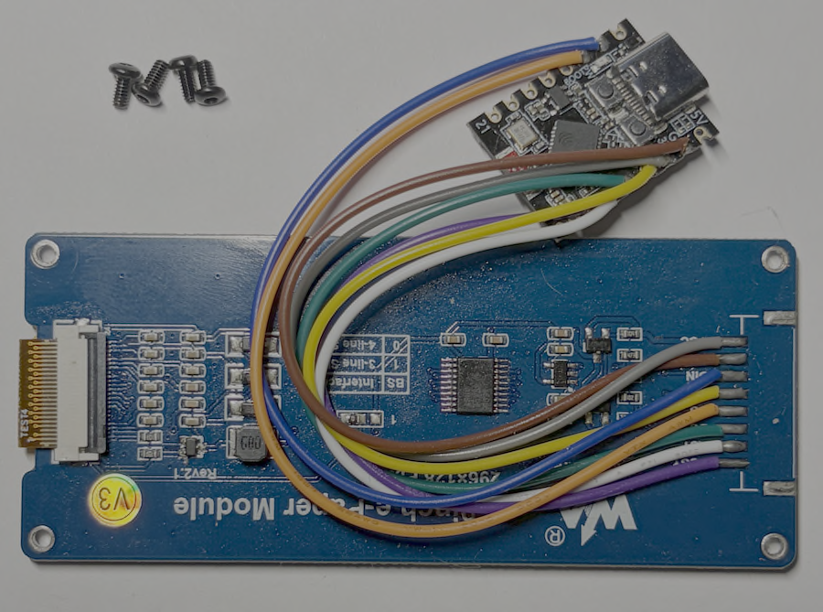

# Hardware and wiring

[Back to README](../README.md) · [Firmware setup](getting-started.md) · [Assembly](assembly.md)

## Supported hardware

- **ESP32-C3 SuperMini**, USB-C, 4 MB flash.
- **Waveshare 2.9-inch black-and-white e-Paper Module V2 / Rev 2.1**,
  SSD1680, 296 × 128 pixels. The controller's native buffer is 128 × 296;
  the dashboard draws in landscape orientation.
- Eight short insulated wires, four M2 × 4 mm screws, and USB power.

Match the display's controller and revision, not just its diagonal size. This
firmware uses the `epd2in9_V2` driver; color panels and other controllers need
their own initialization and waveforms. SuperMini boards also vary in size and
component placement. The enclosure uses a **22.8 × 18 mm** ESP32 PCB reference;
compare your actual board before printing.

## Pin map

| Display label | ESP32-C3 connection | Function |
| --- | --- | --- |
| VCC | 3V3 | Display module power |
| GND | GND | Common ground |
| DIN | GPIO6 | SPI MOSI |
| CLK | GPIO4 | SPI clock |
| CS | GPIO7 | Chip select |
| DC | GPIO3 | Data/command |
| RST | GPIO2 | Display reset |
| BUSY | GPIO1 | Display ready/busy feedback |

The mapping is defined in [epdif.h](../firmware/SEO_Dashboard/epdif.h).
SPI runs at **2 MHz, MODE0, MSB first**. No MISO wire is used. Display power is
continuous from 3V3; this design has no GPIO-controlled power switch.

The display's **RST goes to GPIO2**, not to the ESP32 board's RST/EN contact.
The board's RST button restarts the microcontroller; GPIO2 resets the display.

## Direct wiring

The photograph shows the compact enclosure configuration: the Waveshare pin
connector has been removed, and wires are soldered directly to both boards.
The ESP32 has no pin headers. Use the printed labels and pin map above as the
reference; wire colors are not a specification.

1. Disconnect USB and all other power before wiring.
2. Connect VCC to 3V3 and GND to GND, then the six signal wires.
3. Inspect joints for bridges and verify continuity while unpowered.
4. Keep solder and bare wire ends away from adjacent pads and the display ribbon.
5. Power the assembly and check firmware startup, the settings page, and several
   display refreshes before putting it in the case.

For a bench build, the module's original connector can be used with the same
pin map. It does not fit the compact enclosure configuration shown here.

## USB and buttons

USB-C powers the board and provides the upload/Serial Monitor connection. Use a
data-capable cable for firmware uploads. A USB power supply can run the finished
device; no host computer is needed for normal requests.

The built-in **BOOT button is GPIO9**. It already has the page-navigation
function, so no extra button wiring is needed. Avoid holding BOOT while
powering on or pressing RST: that combination selects the ROM download mode.
USB communication uses GPIO18/19 internally; keep external wiring off those pins.

The supplied case routes the ESP32 USB-C socket to the end where the display
connector originally sat. It has printed actuators for BOOT/RST. The tray keeps
the ESP32 away from the display PCB, and the case/tray stops support the PCB
edge during cable insertion and removal. Check the fit of your cable's plug
housing before closing the lid.

Battery charging and battery operation are not part of this hardware revision.

Continue with [firmware setup](getting-started.md) or
[printing and assembly](assembly.md).
